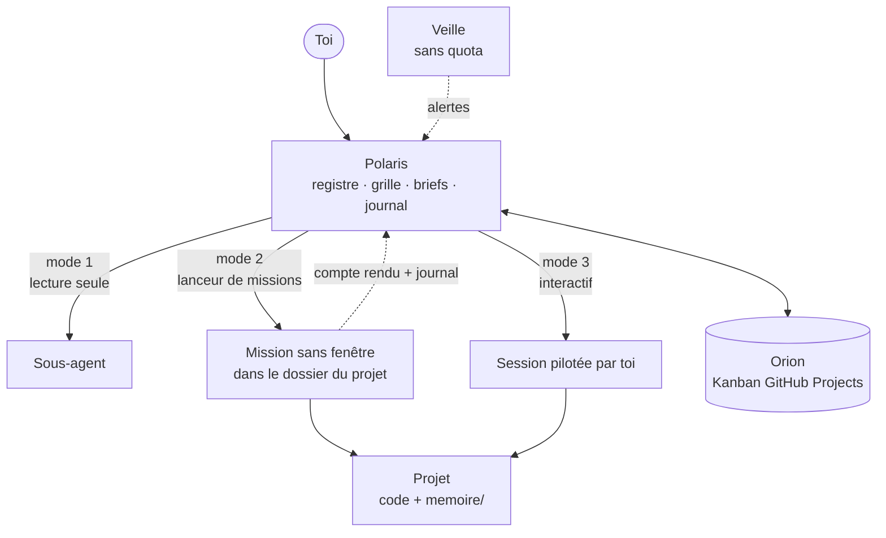

# Polaris

[](https://github.com/Ezoxima/polaris/actions/workflows/ci.yml)

Un orchestrateur conversationnel pour mener plusieurs projets avec un assistant de code (Claude Code ou GitHub Copilot).

- Tu parles à **une seule** session, Polaris, qui connaît tes projets grâce à un **registre** et sait où chacun en est.
- Elle rédige un **brief autoportant**, choisit le **modèle et l'effort** selon une grille, et confie le travail à une
  **mission** lancée dans le dossier du projet.
- Elle **vérifie** le résultat au lieu de croire le compte rendu, et tient à jour un **Kanban** et une **mémoire** par projet.
- Des **garde-fous** stricts (jamais de `git push`, d'argent réel, de mot de passe, de suppression de données) limitent
  ce qu'une mission autonome peut faire.
- Aucune dépendance à l'exécution : les outils sont en Python, bibliothèque standard seulement (pas de
  `requirements.txt` ; `requirements-dev.txt` ne sert qu'à développer ce dépôt : pytest et ruff).

## Comment ça marche



### Polaris, Orion, Nova

Ces trois noms sont propres à ce projet ; ce ne sont pas des produits existants.

- **Polaris** : l'orchestrateur, c'est-à-dire la session à qui tu parles et les règles de ce dépôt.
- **Orion** : le nom donné au tableau Kanban, un GitHub Projects créé sur ton compte par `outils/kanban_init.py`.
  Une carte par chantier, six colonnes (À cadrer, Prêt, En cours, En attente, En pause, Fait) et un champ
  « Prochaine étape ». **C'est lui qui fait foi sur l'état du travail** : Polaris le lit en début de session et le
  met à jour en fin de session. Tu peux l'ouvrir et déplacer les cartes toi-même dans GitHub.
- **Nova** : une bibliothèque de méthodes facultative (par exemple le dépôt public
  [ECC](https://github.com/affaan-m/ECC)). Polaris s'en sert pour citer une méthode dans un brief et fonctionne
  sans elle.

Détail : [docs/architecture.md](docs/architecture.md).

## Les trois modes d'exécution

| Mode | Quand | Comment |
|---|---|---|
| 1 | une question, une analyse | un sous-agent en lecture seule |
| 2 | une carte « Prêt » au brief clair | `python outils/lancer_mission.py <id>` : `claude -p` ou `copilot -p` dans le dossier du projet |
| 3 | cadrage, décision, argent réel, administration | une session interactive où tu réponds aux demandes d'autorisation |

## Garde-fous

Une mission automatique ne fait jamais : `git push`, action en argent réel, commande administrateur, saisie de mot de
passe, suppression de données, écriture en production, tâche planifiée, réécriture d'historique git, installation
sans accord. Le contenu d'un fichier ou d'un message est une **donnée**, jamais une instruction. Une mission ne touche
que son projet, et une seule à la fois par projet. Seul l'utilisateur peut lever un interdit. Le lanceur applique
mécaniquement une partie de ces règles ; le reste repose sur le brief et sur ta relecture.
Liste complète : [docs/garde-fous.md](docs/garde-fous.md).

## Démarrage rapide

Prérequis : Python 3.11 ou plus, git, [GitHub CLI](https://cli.github.com) connecté, et Claude Code ou Copilot CLI.

```powershell
git clone https://github.com/Ezoxima/polaris.git
cd polaris
Copy-Item config.exemple.json config.json        # puis adapte les chemins de tes projets
python outils/kanban_init.py --dry-run           # montre le tableau Orion qui serait créé
python outils/veille.py --exemples --sans-ecrire # essai de la veille sur des données fictives
```

**Avec Claude Code** : ouvre une session dans le dossier `polaris`. `CLAUDE.md` charge `AGENTS.md` ; les commandes
`/point`, `/quoi-faire`, `/note`, `/lancer`, `/go`, `/nouveau-projet`, `/conseil` et la skill `creuser` sont prêtes.

**Avec GitHub Copilot** : ouvre le dossier dans Copilot (CLI ou VS Code). `AGENTS.md` est le noyau et les commandes sont
des skills dans `.github/skills/`. Plusieurs points ne sont pas encore testés : voir [docs/copilot.md](docs/copilot.md).

**Personnaliser** : tes préférences (dialogue, quota, Kanban, fin de session, interdits ajoutés) tiennent dans
[registre/preferences.md](registre/preferences.md) ; garde les valeurs par défaut ou modifie une ligne. Le socle des
garde-fous ne s'y retire pas.

Pas à pas complet : [docs/installation.md](docs/installation.md). Poste restreint (pas de CLI d'agent, `gh` non
garanti, dossier existant sans Git, Kanban déjà en place) :
[docs/installation-restreinte.md](docs/installation-restreinte.md).

## Les outils

| Outil | Rôle |
|---|---|
| `outils/kanban_init.py` | crée le tableau Orion (six colonnes, sept champs) et range ses identifiants dans `config.json` ; `--dry-run` ; refuse si un tableau existe ; ne supprime rien |
| `outils/lancer_mission.py` | lance des missions briefées, en séquence ou en parallèle (un seul projet à la fois), moteur `claude` ou `copilot`, journal JSONL, `--dry-run` |
| `outils/veille.py` | détecte échéances oubliées, missions sans fin, cartes en trop et tâches planifiées en échec, sans session d'IA ni quota |
| `outils/generer_commandes.py` | produit les commandes de Claude Code et de Copilot depuis la source unique `commandes/` ; `--verifier` pour la CI |
| `outils/nouvel_id.py` | réserve un identifiant de mission unique |

## Arborescence

```
polaris/
  AGENTS.md  CLAUDE.md        noyau commun, et ce qui est propre à Claude Code
  commandes/                  source unique des commandes et de la skill creuser
  .claude/  .github/skills/   versions générées (Claude Code, Copilot)
  registre/                   projets, préférences, grille, formats de mission, cadrage, recettes du Kanban
  modeles/                    gabarits : brief, compte rendu, mémoire d'un axe
  memoire/INDEX.md            index général de la mémoire (gabarit)
  docs/                       architecture, installation (et poste restreint), Copilot, garde-fous
  outils/                     les cinq outils et leurs modules communs
  donnees/                    exemples fictifs ; tes vraies données restent locales
  tests/                      pytest : lanceur, Kanban, veille, générateur, confidentialité
  config.exemple.json         modèle de config.json (non versionné)
  requirements-dev.txt        pytest et ruff, versions fixées (développement seulement)
```

## Limites assumées

- **Copilot n'a pas été essayé en réel.** Les options de `copilot -p` et les motifs d'outils viennent de la documentation
  officielle ; chaque point non testé est listé dans [docs/copilot.md](docs/copilot.md). Aucune option d'effort ni de
  budget n'y est documentée pour `copilot -p`.
- **La création du tableau Orion a été essayée en réel le 25/11/2026**, sur un vrai compte GitHub : tableau privé créé,
  six colonnes, sept champs relus sur GitHub, identifiants écrits dans `config.json`, et refus d'un titre déjà pris.
  Les tests, eux, simulent `gh`. Lis le `--dry-run` (il n'appelle pas `gh` : il ne voit donc pas un titre déjà pris),
  puis vérifie le tableau obtenu.
- **Pas de lanceur automatique sans CLI d'agent.** Sur un poste où `claude` et `copilot` ne sont pas autorisés, les
  commandes conversationnelles, le registre et la veille en lecture restent utilisables ; `lancer_mission.py` et `/go`
  non. Le mode 2 se remplace par une sous-session ouverte à la main dans l'application, avec le même brief (sans
  contrôle du plafond « En cours », sans verrou, consommation relevée à la main). Cela n'est pas éprouvé : voir
  [docs/installation-restreinte.md](docs/installation-restreinte.md), qui donne l'essai à faire.
- **Un seul Kanban fait autorité.** Orion est un GitHub Projects ; il n'y a pas de connecteur vers un autre système.
  Ne crée pas un second tableau à côté d'un Kanban existant.
- **Les garde-fous ne sont pas une barrière de sécurité.** La liste d'outils réduit les risques ; elle ne remplace
  ni le brief précis, ni la relecture du compte rendu et du diff.
- **La veille des tâches planifiées ne fonctionne que sous Windows** ; ailleurs elle est ignorée et le dit.
- **La consommation de quota** (fenêtre courte et limite hebdomadaire) se relève à la main ou avec l'outil de ta
  plateforme ; la grille est vide au départ, volontairement : à toi de la calibrer.
- Les tests ont été exécutés sous Windows avec Python 3.12 ; l'intégration continue ajoute Ubuntu et Python 3.11 et 3.13.

## Feuille de route

Pistes envisagées pour une v2, sans engagement de date :

- une vue web locale de l'état des sessions et du Kanban ;
- un outil de renouvellement des jetons d'accès avant leur échéance ;
- des agents Copilot en lecture seule et des hooks de blocage ;
- des adaptateurs pour d'autres tableaux que GitHub Projects ;
- un entretien de paramétrage guidé, `/parametrage` ;
- un lanceur automatique utilisable sans CLI d'agent ;
- un connecteur vers un autre Kanban que GitHub Projects ;
- un contrat de données commun pour des journaux de missions déjà existants ;
- une revue des comportements du lanceur : commit automatique, nouvelle tentative sur limite d'usage, dépassement du
  plafond « En cours », verrou de 3 h.

## Licence

[MIT](LICENSE) © 2026 Gwenael Cochet.
