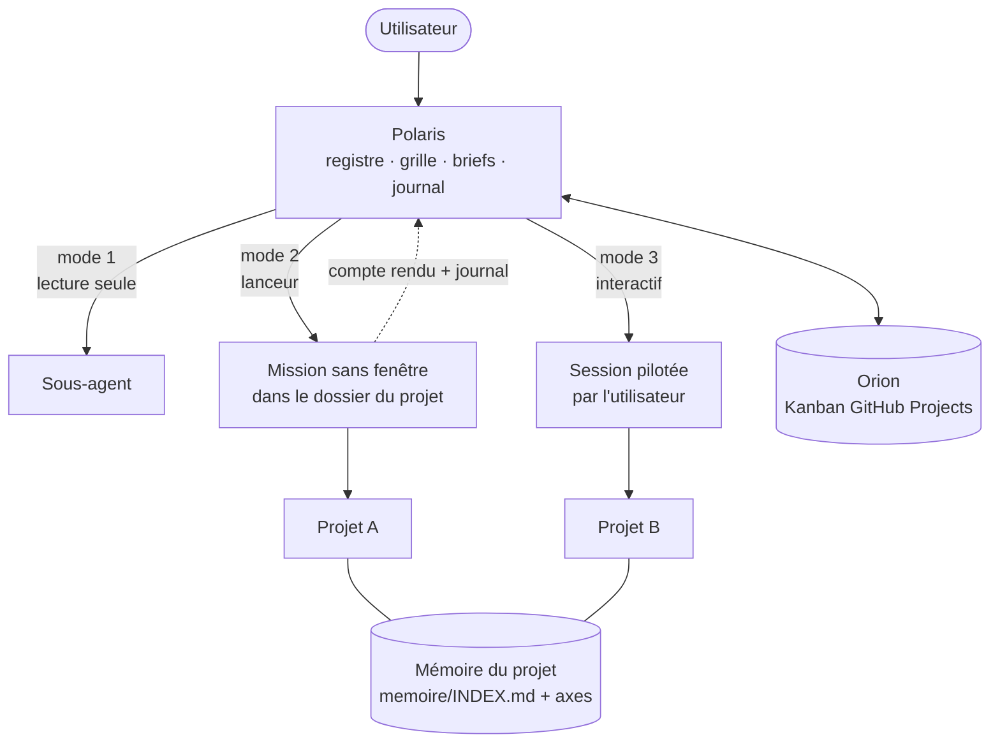

# Architecture de Polaris

## 1. But

Quand on mène plusieurs projets, on oublie où on en était, on hésite sur ce qu'il faut faire ensuite, on oublie
qu'un script tourne (ou ne tourne plus), et les notes de reprise périment. Polaris règle cela avec **un seul
interlocuteur** : une session conversationnelle qui connaît tous les projets, sait où chacun en est, et confie le
travail à des sessions dédiées avec un modèle et un effort adaptés.

Trois noms :

- **Polaris** : l'orchestrateur, ce dépôt. Il guide.
- **Orion** : le Kanban, un tableau GitHub Projects. Il montre le travail.
- **Nova** : une bibliothèque de méthodes **facultative** (par exemple le dépôt public
  [ECC](https://github.com/affaan-m/ECC)). Polaris fonctionne sans elle.

Polaris **n'écrit pas de code dans les projets**. Il comprend, choisit, rédige le brief, lance, suit, vérifie et
rend compte.

## 2. Vue d'ensemble

## 3. Composants

### 3.1 Le noyau : `AGENTS.md`

Court et déclaratif, chargé à chaque session : chaque ligne coûte à chaque échange. Il contient le rôle, les
renvois vers le registre et la grille, l'aiguillage et les garde-fous. `CLAUDE.md` l'importe et n'ajoute que ce
qui est propre à Claude Code. Copilot lit `AGENTS.md` directement ([copilot.md](copilot.md)).

### 3.2 Le registre : `registre/`

Chaque fichier `registre/X.md` peut être remplacé **entièrement** par `registre/X.local.md` (personnel, ignoré par git) :
si ce dernier existe, on lit celui-là et jamais le générique (règle écrite dans `AGENTS.md`).

- `projets.md` : une fiche par projet : chemin, statut, phase, mots-clés de reconnaissance, règles sensibles,
  tâches planifiées, secrets (**noms** seulement). Les mots-clés permettent d'aiguiller une demande
  (« le pipeline ne tourne plus ») vers le bon projet **sans relire les projets** : c'est de l'économie de jetons.
- `grille.md` : le modèle, l'effort et la durée max selon le type de tâche, et un tableau de consommation mesurée.
- `mission.md` : les formats du brief, du compte rendu et du journal.
- `cadrage.md` : le modèle du document de cadrage d'un nouveau projet.
- `kanban.md` : les recettes `gh` d'Orion.

**Statut** d'un projet : Actif, En pause (volontaire : la fiche dit où l'on s'est arrêté et ce qui ferait repartir),
Fini, À supprimer.

**Variante** : dimension transverse facultative. Quand un projet existe en plusieurs variantes (un client, un
environnement, une plateforme), la fiche peut porter une matrice capacité × variante, la carte une variante, et
une mission ne traite qu'**une** variante. À la clôture d'un chantier, Polaris propose de le répliquer dans les
autres variantes. Un projet sans variante ignore cette dimension.

### 3.3 La grille modèle / effort

Elle est exprimée par **classes** de modèle (léger, standard, raisonnement fort), à traduire en noms réels selon
la plateforme (voir `registre/grille.md`). Principes :

- le code s'écrit avec le modèle **standard** ; le modèle fort sert au diagnostic, à l'architecture et au cadrage ;
- l'effort du modèle fort a un **plafond** (`high` par défaut), que le lanceur applique ;
- une tâche trop grosse n'est jamais confiée d'un bloc : on la découpe ;
- Polaris annonce le couple choisi avant de lancer ; l'utilisateur peut le changer ;
- la durée max est une limite dure : la session est arrêtée après avoir laissé un compte rendu.

### 3.4 Le format de mission

Le **brief** est autoportant : la carte et l'objectif en une phrase, la prochaine étape et le critère de fin, les
méthodes à appliquer (0 à 2), les fichiers à lire d'abord, le périmètre (autorisé, interdit, permissions
anticipées) et l'exécution (modèle, effort, mode, durée max, consommation estimée). Le **compte rendu** est exigé
en fin de session. Formats exacts : `registre/mission.md` et `modeles/`.

### 3.5 Le journal : `donnees/missions.jsonl`

Une ligne JSON par événement (créée, lancée, terminée, échouée, arrêtée, permission manquante, mesure). Il sert à
détecter une mission sans fin, à calibrer la consommation et à retrouver qui a fait quoi.

### 3.6 Orion : le Kanban

Mémoire de travail de Polaris. Six colonnes : **À cadrer · Prêt · En cours · En attente · En pause · Fait**.
Champs : Nature (Chantier, Démarche, Décision, Script, POC), Projet, Taille (XS à XL), Phase (POC, MVP, Produit
final), Prochaine étape, `% 5 h` et `% hebdo` (consommation estimée ou mesurée). `outils/kanban_init.py` crée ce
tableau et range ses identifiants dans `config.json`.

- Aucun plafond de cartes « En cours » : le lanceur ne lit pas Orion. Seule règle mécanique : une mission à la fois
  par projet (verrou du journal).
- Le champ **Projet** est un champ texte : un choix unique perdrait la valeur des cartes à chaque ajout d'option.
- Les cartes sont des brouillons, sans dépôt lié : la description porte tout le contexte, l'état qui bouge va dans
  « Prochaine étape ».
- Un POC ne se lance jamais directement : il passe d'abord par `/note` ou `/nouveau-projet`.

### 3.7 Les commandes

| Commande | Rôle |
|---|---|
| `/point` | Où j'en suis partout : alertes de la veille, en cours, échéances, quota |
| `/quoi-faire` | Propose 2 ou 3 cartes selon le temps ou l'envie, avec leur consommation estimée |
| `/note` | Transforme une idée en carte « À cadrer » |
| `/lancer` | Rédige le brief d'une carte, choisit modèle et effort, affiche le récapitulatif, lance |
| `/go` | Lance un ou plusieurs briefs déjà écrits via `outils/lancer_mission.py` |
| `/nouveau-projet` | Entretien de cadrage, dossier, fiche du registre, cartes (phase POC) |
| `/conseil` | Quatre avis contradictoires sur un cadrage, sur demande seulement |
| `/configurer` | Accueil : inventaire des capacités, projets, Kanban, voie de lancement, modèles ; une question à la fois |
| `creuser` (skill) | Entretien serré, une recommandation par question, utilisé par les commandes ci-dessus |

Les sources sont dans `commandes/` ; `outils/generer_commandes.py` produit les fichiers de Claude Code
(`.claude/`) et de Copilot (`.github/skills/`).

### 3.8 Nova : méthodes facultatives

Si une bibliothèque de méthodes existe (agents, skills), Polaris y choisit **0 à 2 fichiers** par mission et les
cite avec leur chemin dans le brief. La mission ne lit que ceux-là. Un fichier introuvable ou inutilisable est
signalé, jamais prétendu appliqué. Le `AGENTS.md` du projet prime. Un index d'une ligne par fichier
(`registre/nova.md`) évite de tout parcourir.

## 4. Les trois modes d'exécution

| Mode | Quand | Comment | Limites |
|---|---|---|---|
| **1. Sous-agent** | Question, analyse, inventaire | Agent en lecture seule dans la session de Polaris | Ne modifie rien ; ne charge pas seul les règles du projet (le brief le lui fait lire) |
| **2. Session sans fenêtre** | Carte « Prêt » au brief clair | Lanceur : `claude -p` ou `copilot -p` dans le vrai dossier du projet | Ne peut pas demander d'autorisation : liste blanche d'actions |
| **3. Session interactive** | Cadrage, décision, argent réel, administration | Polaris prépare le brief ; l'utilisateur pilote la session | Coûte du temps de l'utilisateur |

### Mode 2 par paliers

Le mode 2 se lance par la meilleure voie **disponible**, que `python outils/capacites.py --voie` propose d'après
l'inventaire des capacités du poste et la préférence `voie_preferee` de `config.json`. L'utilisateur accepte la voie
dans le récapitulatif ; elle n'est jamais choisie en silence.

- **`cli`** : le lanceur (`outils/lancer_mission.py <id>`), qui applique tous les contrôles ci-dessous.
- **`sous_session`** : la plateforme ouvre une session avec le prompt autonome (`outils/lancer_mission.py --prompt
  <id> --voie sous_session`).
- **`prompt`** : le même texte, à copier dans une nouvelle session (`--prompt <id>`).

`--prompt` écrit `briefs/<id>-prompt.md` (projet, contexte, périmètre, garde-fous, critère de fin, compte rendu
attendu, recommandation de modèle et d'effort, liste des contrôles non garantis) et note `preparee` au journal ; il ne
lance rien. Le moteur (`--moteur`, sinon `moteur_par_defaut`) ne sert qu'à choisir la liste d'outils du projet : il est noté
`moteur_vise` au journal, car aucun moteur n'est lancé ; le dry-run, le prompt et la note `preparee` disent la **source**
du moteur (`--moteur`, `moteur_par_defaut`, ou « moteur non configuré, `claude` par défaut »). `--dry-run` n'écrit rien
et n'exige aucun CLI.

**Finaliser à la main.** Ces voies n'ont pas de lanceur pour recueillir le compte rendu. Le prompt le dit à la fin
(« À faire à la main ») : l'utilisateur sauvegarde le dernier message de la session dans un fichier, puis lance
`python outils/lancer_mission.py <id> --terminer --compte-rendu <fichier> --voie prompt|sous_session`. Cette commande
ne lance aucun moteur : elle copie le texte dans `briefs/<id>-compte-rendu.md` (un précédent est archivé) et écrit la
ligne `terminee` (avec la voie) au journal. Le pied du prompt dépend du projet : sans dépôt git, pas de règle de
commit (preuves = tests et fichiers modifiés) ; la section « Carte » n'existe qu'avec `kanban.mode` à `github`
(`manuel` : section à reporter à la main, `aucun` : aucune section).

Contrôles garantis, par voie (ce tableau est produit par `outils/capacites.py` ; un test le garde à l'identique) :

<!-- debut tableau controles -->
| Contrôle | cli | sous_session | prompt |
|---|---|---|---|
| verrou par projet (une mission à la fois) | oui — refus si une autre mission est en cours sur le même projet | non — rien n'empêche deux missions sur le même projet : vérifie à la main | non — rien n'empêche deux missions sur le même projet : vérifie à la main |
| durée max | oui — arrêt de l'arbre de processus à la durée du brief | non — aucun arrêt automatique : surveille la session | non — aucun arrêt automatique : surveille la session |
| journal automatique | oui — `lancee`, puis `terminee`, `echouee` ou `arretee` | non — seule `preparee` est écrite ; lancement et fin sont à noter à la main | non — seule `preparee` est écrite ; lancement et fin sont à noter à la main |
| permissions (liste d'outils) | oui — liste d'outils autorisés et interdits passée en ligne de commande | non — réglages de la plateforme, pas la liste d'outils de Polaris | non — réglages de la session où tu colles le prompt, pas la liste d'outils de Polaris |
| relevé de consommation | partiel — Claude : coût lu ; Copilot : fichier d'usage si l'option existe, format non garanti | non — à relever à la main | non — à relever à la main |
| arrêt d'urgence donnees/STOP | oui — plus aucune nouvelle mission ne démarre ; celle en cours finit | non — `donnees/STOP` n'est lu que par le lanceur | non — `donnees/STOP` n'est lu que par le lanceur |
<!-- fin tableau controles -->

Une voie de repli n'est **jamais équivalente** au lanceur : le récapitulatif dit ce qui manque. **Après un refus de
permission ou un échec, on s'arrête et on explique** ; on ne passe pas de soi-même à une autre voie.

**Quand une session sans fenêtre manque d'une permission** : *avant*, le brief liste les permissions anticipées et
Polaris vérifie qu'elles sont dans la liste blanche ; *pendant*, l'action refusée n'est pas contournée et la session
s'arrête proprement en le disant ; *après*, l'utilisateur choisit entre accorder la permission pour cette mission
seulement, passer en mode 3 ou redécouper. Les manques sont notés au journal.

**Ce que l'usage a appris** :

- La liste d'outils autorisés n'est pas une garantie absolue : le brief reste la règle et Polaris relit toujours.
- Les écritures hors du dossier de la mission, ou dans le dossier de configuration de l'outil, sont refusées : la
  mission renvoie son compte rendu dans sa réponse et le lanceur l'enregistre.
- Polaris vérifie après coup : tests relancés, fichiers relus, et pour un serveur ou une page, un rendu réel.
- Un serveur dont le code a changé doit être relancé : un ancien processus répond avec l'ancien code.

## 5. Veille

`outils/veille.py` détecte ce qu'on oublie **sans session IA**, donc sans consommer de quota : échéances dépassées ou
proches, missions lancées sans fin au journal, tâches planifiées en échec (Windows,
lecture seule). Elle n'écrit que `donnees/veille.json` (et rien avec `--sans-ecrire`, comme le fait `/point`, car aucun
outil ne relit ce fichier), ne crée jamais de carte ni de tâche : `/point` propose, l'utilisateur valide.

## 6. Économie de jetons

L'abonnement à quota est partagé entre Polaris, ses sous-agents et ses missions. Chaque brique est conçue pour
consommer peu :

- découper en sessions seulement quand cela économise vraiment (voir 6.2) ;
- lire de l'état compact (registre, cartes, fiches) et déléguer la lecture détaillée à la mission ;
- des briefs précis, pour qu'une mission n'ait pas à explorer le dépôt ;
- le modèle standard par défaut, le modèle fort quand la grille le dit, le léger pour le reste ;
- peu de sous-agents : un seul quand une lecture large le justifie ;
- des fichiers chargés à chaque session courts (`AGENTS.md`, fiches du registre) ;
- une mesure avant/après chaque mission, inscrite au journal, pour corriger la grille.

### 6.1 Mémoire et contexte

| Nature | Contenu | Change… | Chargée… |
|---|---|---|---|
| **Règles** (`AGENTS.md`) | Comment travailler dans le dépôt | rarement | toujours, donc court |
| **Mémoire** | Faits durables : décisions, pièges, pourquoi | parfois | à la demande, via un index |
| **Contexte** | État courant, prochaine étape | à chaque session | au début, pour l'axe concerné seulement |
| **Référence** | Spécifications, décisions numérotées | rarement | sur renvoi |

Mémoire et contexte vivent dans **un fichier par axe**, en deux sections : « Faits durables » et « État au JJ/MM ».
Ils sont rangés **dans chaque dépôt, versionnés** : `<projet>/memoire/INDEX.md` et `<projet>/memoire/<axe>.md`.
Polaris tient l'index général dans `memoire/INDEX.md`. Cela rend la mémoire lisible par n'importe quelle session
et indépendante de la plateforme.

Documentation à trois niveaux : **fin de session**, un journal de 5 à 10 lignes ; **fin de tâche** (carte « Fait »),
l'essentiel passe en « Faits durables » et le journal est purgé ; **fin de phase**, une documentation lisible
(README, guide d'usage). On ne rédige jamais de documentation longue à chaque session : c'est ce qui coûte cher
et ce qui périme.

### 6.2 Découper les sessions et compacter

Ce qui coûte : le démarrage (outils et règles chargés d'office), la relecture de l'historique à chaque tour, la
péremption du cache après environ une heure d'inactivité, et la ré-exploration d'une session neuve.

- **Ouvrir une nouvelle session** : changement de sujet, pause longue avec gros historique, historique long et
  presque inutile pour la suite.
- **Rester dans la même** : la suite a besoin de ce qu'on vient de lire, on enchaîne, l'historique est petit.
- **Condition** : on ne découpe que si le relais est écrit (fichier d'axe, brief). Sinon on paie la ré-exploration.
- **Compacter** : au bon moment (fin de sous-étape, jamais en plein travail), assez tôt (vers 150 à 200 k jetons),
  après avoir écrit l'essentiel dans les fichiers, et avec des consignes, par exemple
  `/compact garde les décisions, les fichiers modifiés et la prochaine étape ; jette les sorties d'outils`.
  Polaris signale le moment ; la commande est tapée par l'utilisateur.

## 7. Cycle de vie d'un nouveau projet

**POC, puis MVP, puis Produit final.** Chaque phase a son plan, cadré en mode 3 avant de commencer, et sa carte de
passage : « passer en MVP » est une décision de l'utilisateur. La phase courante figure dans la fiche du registre
et sur les cartes.

## 8. Ce que l'utilisateur fait lui-même

Piloter les sessions de mode 3 ; accorder ou refuser les permissions manquantes ; saisir mots de passe et codes ;
décider de tout `git push` ; créer et modifier les tâches planifiées ; lire le compte rendu d'une mission avant de
lui faire confiance.
